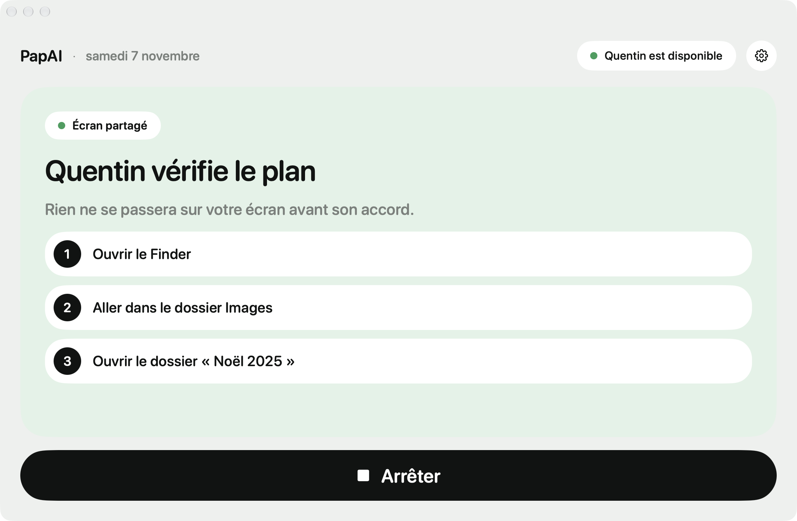
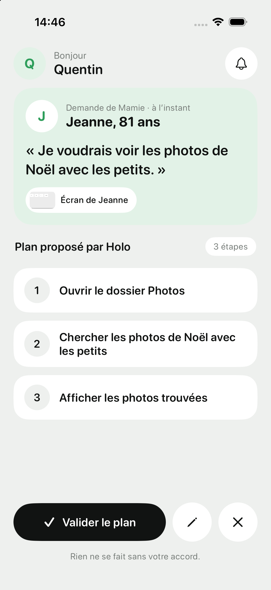

<p align="center"></p>

# PapAI

Le support informatique de premier niveau, automatisé. Un service IT, ou un proche,
fournit et valide des automatismes ; chacun les lance seul, en un clic, sur son ordinateur.
Exemple de cas d'usage : un grand-parent aidé par ses enfants. Autre exemple : les employés
d'une entreprise (scan antivirus, imprimante, modèles Word, moteur de recherche).

Hackathon H Company × 42 AI, 7-8 novembre 2026. Agent : **Holo** (H Company).

## La boucle

1. **Demander** : la personne aidée appuie sur « Demander une assistance » et explique avec ses mots.
2. **Proposer** : Holo regarde l'écran et propose un plan de 2 à 5 étapes.
3. **Valider** : le support reçoit une notification sur son iPhone, puis valide, précise ou refuse. Rien ne bouge avant.
4. **Exécuter** : Holo agit, la personne regarde, et peut tout arrêter à tout moment.
5. **Garder** : la tâche devient un automate, une tuile que la personne relance seule.
6. **Importer** : le support fournit un automate (fichier `.papai`, [exemples](automations/)) et le valide en l'important. Seulement des actions de premier niveau, jamais de commande ni de script. Format : [`PROTOCOL.md`](PROTOCOL.md#automates-importés-par-un-support-fichier-papai).

> Ce qui reste à faire, par priorité : [`TODO.md`](TODO.md). Agents de l’équipe : lisez-le avant de coder.

## Aperçu

| Personne aidée (Mac) | Aidant (iPhone) |
|---|---|
|  |  |

## Architecture

```
Mac de la personne aidée         Serveur PapAI (Cloud Run)          H Company
  apps/mac  (SwiftUI)    ──wss──▶  backend/ (FastAPI)    ──HTTPS──▶  Holo
  capture, clics, Arrêter          plan, validation, agent,
  automates locaux                 garde-fous, journal
                                          ▲
                                          │ wss
                                 iPhone du support
                                   apps/ios (SwiftUI)
```

- **Le serveur décide, les apps exécutent.** Contrat exact : [`PROTOCOL.md`](PROTOCOL.md).
- **En ligne sur Cloud Run** (europe-west1). Toutes les routes passent par `/k/<clé famille>/…`. Sans la clé, rien ne répond. La clé n'est pas dans le dépôt.
- **Garde-fous** :
  - le bouton Arrêter est un verrou local sur le Mac, valable même hors ligne ;
  - aucune action sans plan validé, par l'aidant ou par le support à l'import ;
  - pas de surveillance continue de l'ordinateur ;
  - la fenêtre PapAI est exclue des captures et des clics ;
  - toute demande du support est revalidée côté serveur.
- **Windows** : `apps/windows`, mêmes écrans et même design que l'app Mac (Python + pywebview/WebView2) : double-cliquer `apps\windows\PapAI.bat`, rien à installer. Pas encore essayée sur un vrai Windows. L'ancien prototype reste dans la branche `archive/windows-7-nov`.

## Structure

```
backend/        serveur FastAPI : sessions, plan, boucle agent Holo, garde-fous
papai_tools.py  contrat avec Holo : outils, prompts Mac et Windows
apps/mac/       app SwiftUI de la personne aidée (capture, clics, Arrêter, automates)
apps/ios/       app SwiftUI du support (validation, capture en direct, prise de main)
brand/          logo et icônes (SVG)
PROTOCOL.md     messages échangés entre le serveur et les apps
automations/    exemples d'automatismes importables (.papai)
```

## Lancer

**Serveur en local** (pour développer) :
```bash
cp .env.example .env            # puis coller HAI_API_KEY
uv venv -p 3.12 .venv-mac && uv pip install -p .venv-mac -r requirements-backend.txt
PAPAI_AIDANT_KEY=demo PORT=8000 .venv-mac/bin/python -m backend.app
```

**Serveur en ligne** :
```bash
gcloud run deploy papai --source . --region europe-west1 --allow-unauthenticated \
  --set-env-vars PAPAI_PUBLIC=1,PAPAI_AIDANT_KEY=<clé>,HAI_API_KEY=<clé H> \
  --min-instances 1 --max-instances 1 --timeout 3600 --session-affinity --no-cpu-throttling
```

**App Mac** : `apps/mac/scripts/install-mac.sh` installe `~/Applications/PapAI.app`.
- Réglages (engrenage) → serveur `wss://<hôte>/k/<clé>/ws/bridge`.
- Autoriser Enregistrement de l'écran et Accessibilité dans Réglages Système.

**App iPhone** : `apps/ios/scripts/install-iphone.sh`, avec l'iPhone branché et le Mode développeur activé.
- Réglages (avatar) → serveur `https://<hôte>/k/<clé>` et la clé.
- Avec un compte Apple gratuit, réinstaller tous les 7 jours.

## État au 7 novembre au soir

| Brique | État |
|---|---|
| Plan proposé par Holo, précisé ou validé par l'aidant | ✅ testé de bout en bout en ligne |
| App Mac : connexion, capture sans sa fenêtre, plan affiché | ✅ |
| App Mac : vrais clics CGEvent, bouton Arrêter | ⬜ codés, pas encore exercés |
| App iPhone : validation, précision, capture en direct, prise de main | ✅ simulateur, installée sur l'iPhone |
| Notifications iPhone | ⬜ app au premier plan uniquement |
| Automates (rejeu local, alerte si dossier absent) | ⬜ codés, à exercer |
| Gardien anti-arnaque, rangement guidé, voix | idées, voir le Notion |

Design : variante « Soin » (Figma). Logo : logotype « papai » dont le point du i est une papaye.
